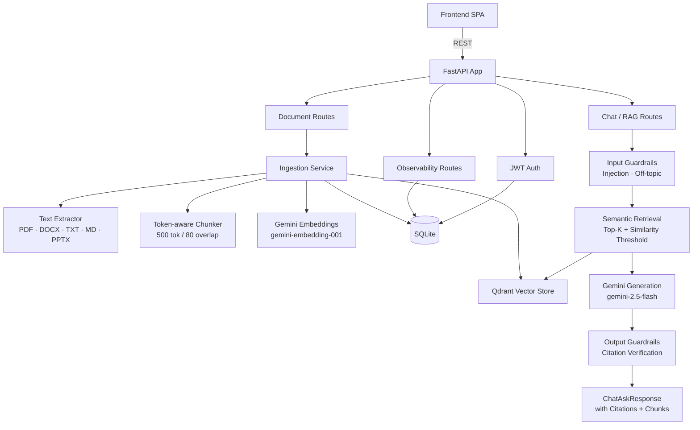

# Production RAG Document Chatbot

> **Portfolio Project 1** — A production-grade Retrieval-Augmented Generation (RAG) API with document ingestion, grounded citations, JWT authentication, guardrails, observability, and a modern single-page web UI.

[](https://fastapi.tiangolo.com)
[](https://python.org)
[](https://qdrant.tech)
[](https://ai.google.dev)

---

## Architecture



---

## Quickstart (3 commands)

```bash
# 1. Install dependencies
pip install -r requirements.txt

# 2. Configure environment
cp .env.example .env   # then edit GEMINI_API_KEY (and QDRANT_* if using Cloud)

# 3. Start the server
uvicorn app.main:app --reload
```

Open **http://localhost:8000** for the web UI, or **http://localhost:8000/docs** for the Swagger API explorer.

---

## Docker

```bash
docker compose up --build
```

Services:
- `app` — FastAPI on port `8000`
- `qdrant` — Qdrant vector DB on port `6333` (local mode only)

---

## API Endpoints

| Method | Path | Description |
|--------|------|-------------|
| `GET`  | `/health` | Service health check |
| `POST` | `/api/auth/signup` | Register a new user |
| `POST` | `/api/auth/login` | Login and get JWT token |
| `GET`  | `/api/auth/me` | Get current user profile |
| `POST` | `/api/documents/upload` | Upload and ingest a document |
| `GET`  | `/api/documents` | List all uploaded documents |
| `DELETE` | `/api/documents/{id}` | Delete a document and its vectors |
| `POST` | `/api/chat/ask` | Ask a question over uploaded documents |
| `GET`  | `/api/metrics/summary` | Aggregated observability metrics |
| `GET`  | `/api/metrics/traces` | Raw request trace records |
| `GET`  | `/docs` | Interactive Swagger UI |

---

## Environment Variables

| Variable | Default | Description |
|----------|---------|-------------|
| `GEMINI_API_KEY` | *(required)* | Google Gemini API key |
| `GEMINI_LLM_MODEL` | `gemini-2.5-flash` | LLM for generation |
| `GEMINI_EMBEDDING_MODEL` | `gemini-embedding-001` | Embedding model |
| `QDRANT_MODE` | `local` | `local` or `cloud` |
| `QDRANT_PATH` | `./qdrant_storage` | Local Qdrant storage path |
| `QDRANT_URL` | — | Qdrant Cloud URL |
| `QDRANT_API_KEY` | — | Qdrant Cloud API key |
| `SQLITE_DB_PATH` | `./data/rag_service.db` | SQLite database path |
| `JWT_SECRET_KEY` | *(set in .env)* | JWT signing secret |
| `JWT_EXPIRE_MINUTES` | `1440` | JWT token lifetime |
| `SIMILARITY_THRESHOLD` | `0.35` | Min cosine similarity for retrieval |
| `RETRIEVAL_TOP_K` | `5` | Chunks retrieved per query |
| `CHUNK_SIZE_TOKENS` | `500` | Chunk size for splitting |
| `CHUNK_OVERLAP_TOKENS` | `80` | Overlap between adjacent chunks |
| `RATE_LIMIT_ASK` | `20/minute` | Rate limit for /api/chat/ask |
| `RATE_LIMIT_UPLOAD` | `10/minute` | Rate limit for /api/documents/upload |
| `APP_ENV` | `development` | Environment tag |

---

## Supported File Types

| Extension | Parser |
|-----------|--------|
| `.pdf` | PyMuPDF (text + OCR fallback) |
| `.docx` | python-docx |
| `.pptx` | python-pptx |
| `.txt` | UTF-8 / Latin-1 |
| `.md` | Markdown text |

---

## Running the Evaluation

```bash
# 1. Make sure server is running (see Quickstart)
# 2. Upload all sample docs via the UI or API
# 3. Run:
python evals/run_eval.py
# Outputs: evals/eval_results.json + EVAL.md
```

See [EVAL.md](EVAL.md) for the latest evaluation results.

---

## Project Structure

```
├── app/
│   ├── main.py                  # FastAPI app factory
│   ├── config.py                # Settings (Pydantic)
│   ├── schemas.py               # Request/response models
│   ├── dependencies.py          # Dependency injection
│   ├── guardrails.py            # Input + output guardrails
│   ├── generation.py            # Gemini LLM generation
│   ├── retrieval.py             # Semantic retrieval
│   ├── ingestion/               # Text extractors
│   ├── routes/
│   │   ├── auth.py              # JWT auth endpoints
│   │   ├── chat.py              # RAG chat endpoint
│   │   ├── documents.py         # Document CRUD
│   │   └── metrics.py           # Observability metrics
│   └── services/
│       ├── auth_service.py      # JWT + bcrypt
│       ├── database.py          # SQLite manager
│       ├── embeddings.py        # Gemini embeddings
│       ├── ingestion_service.py # Upload orchestration
│       ├── rag_service.py       # RAG orchestration + telemetry
│       └── vector_store.py      # Qdrant wrapper
├── frontend/
│   ├── index.html               # SPA entry point
│   ├── style.css                # Dark-mode design
│   └── app.js                   # API client + UI logic
├── evals/
│   ├── golden_qa_dataset.json   # 36-question golden set
│   └── run_eval.py              # RAGAS-style evaluator
├── sample_docs/                 # Sample corporate documents
├── tests/                       # Pytest test suite
├── notebooks/                   # RAG pipeline testing notebook
├── DESIGN.md                    # Technical design decisions
├── EVAL.md                      # Evaluation results
├── AI_USAGE.md                  # AI assistance log
└── docker-compose.yml           # Docker deployment
```

---

## Bonus Features

| ID | Feature | Status |
|----|---------|--------|
| B1 | JWT Authentication (signup / login / /me) | ✅ |
| B2 | Multi-format ingestion (PDF, DOCX, PPTX, TXT, MD) | ✅ |
| B3 | Observability metrics API (`/api/metrics/*`) | ✅ |
| B4 | Frontend SPA with glassmorphism UI | ✅ |
| B5 | Similarity threshold abstention | ✅ |
| B6 | Input/output guardrails (injection, off-topic) | ✅ |
| B7 | Duplicate detection (SHA-256) | ✅ |
| B8 | Telemetry: latency, tokens, cost tracking | ✅ |

---

## License

MIT © 2024 TechNova AI